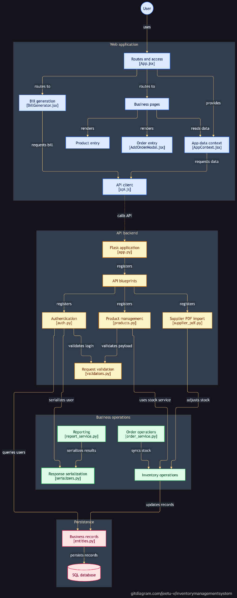

# Inventory Management System

A full-stack inventory management application for managing products, suppliers, customers, orders, stock, sales, and profit reporting.

## Architecture



The React frontend communicates with a Flask REST API. The backend organizes API routes, business services, data validation, and SQLAlchemy models. SQLite is used for local development; production requires a persistent MySQL database configured through `DATABASE_URL`.

## Demo

[Watch or download the demo video](demo-video/inventory-management-demo.mp4).

## Features

- Dashboard with inventory and sales summaries
- Product, supplier, and customer management
- Order entry, order cancellation, and bill generation
- Business-specific bill branding from workspace name and storefront contact settings
- Inventory transactions and low-stock tracking
- Sales and profit reporting
- JWT authentication and role-based access for administrative features
- Supplier PDF import

## Business workspaces

The SaaS foundation supports business registration, multiple businesses per
user, workspace switching, business-specific roles, and tenant-scoped access to
the existing inventory APIs. New users can create an owner account and initial
business from the sign-in page. Existing legacy databases must be backed up and
migrated from `backend/` with `flask db upgrade`; the migration assigns legacy
inventory records and users to one default business.

Authenticated API requests select a workspace with `X-Business-Id`. The
frontend sets this header from the active business selector.

Customers can create a separate portal account for a business using its
workspace slug at `/portal/login`, then review their own order history at
`/portal/dashboard`. Portal credentials are separate from staff accounts.
Existing customer records must have portal access activated by a business
administrator; the one-time temporary password is shown once and must be
changed at first sign-in.

### Shop-specific workspaces and storefronts

Each business has a shop URL based on its unique slug. Owners sign in and work
within that shop at `/shop/<slug>` (for example, `/shop/corner-shop`), with
storefront options at `/shop/<slug>/settings`. Customers can browse the public
catalogue at `/shop/<slug>/customer`, create or sign in to a customer account,
and manage that shop's profile, cart, checkout, orders, and receipts there.

Customer accounts can be reused across shops, while each shop keeps its own
customer profile and order history. Public catalogues expose available products
and selling prices, not inventory quantities, supplier details, or purchase
costs. Disabling a shop's storefront prevents public browsing and ordering but
does not disable the owner's private workspace. The earlier `/portal` customer
experience remains available for accounts activated by a shop administrator.

Platform administrators sign in at `/platform-admin/login`. The platform-only
console includes shop owner accounts, business registrations and access status,
manual subscription plans and assignments, aggregated enrollment summaries,
technical health, internal support cases, and an administrative audit log.
Suspending an owner account or business blocks access while preserving records.
Plan prices are catalog values only; payment collection and automated billing
are not implemented.

Platform administration uses a separate session from business sign-in:
platform sessions cannot access business APIs, and business sessions cannot
access platform administration APIs. Owner contact and workspace enrollment
details are available to platform administrators, but tenant sales, profit,
products, customers, and orders are not exposed in the platform console.
Access is restricted to emails listed in `PLATFORM_ADMIN_EMAILS`; production
requires this allowlist, strong `SECRET_KEY` and `JWT_SECRET_KEY` values, and a
MySQL `DATABASE_URL`. Production never loads a checked-in `.env` file or uses
development credential defaults. Configure these values in the deployment
provider's environment settings.

After upgrading an existing database with `flask db upgrade`, the platform
administrator can create plans and assign them to registered businesses. The
same migration creates tables for internal support cases and platform audit
events.

## Technology

- Frontend: React, Vite, Tailwind CSS
- Backend: Python, Flask, SQLAlchemy, Flask-JWT-Extended
- Database: SQLite for local development; MySQL for production

## Local development

Prerequisites: Node.js/npm and Python 3.

1. Install frontend dependencies:

   ```bash
   npm install --prefix frontend
   ```

2. Create and install the backend environment:

   ```bash
   python3 -m venv backend/venv
   backend/venv/bin/pip install -r backend/requirements.txt
   ```

3. Configure the backend. The app uses SQLite if `DATABASE_URL` is unset in
   development. For local development, create `backend/.env` with private
   values for at least:

   ```dotenv
   SECRET_KEY=replace-with-a-private-random-value-of-at-least-32-characters
   JWT_SECRET_KEY=replace-with-a-different-private-random-value-of-at-least-32-characters
   DEFAULT_ADMIN_EMAIL=admin@example.com
   DEFAULT_ADMIN_PASSWORD=replace-with-a-strong-password
   PLATFORM_ADMIN_EMAILS=admin@example.com
   CORS_ORIGINS=http://localhost:5173
   ```

   To use another database, set `DATABASE_URL` to its SQLAlchemy connection URL.

4. For a completely empty local database, initialize the current schema and
   seed the initial owner/platform administrator. This stamps Alembic at the
   current migration head, so do not run `flask db upgrade` afterward:

   ```bash
   cd backend
   ./venv/bin/python init_db.py
   ./venv/bin/python app.py
   ```

   For an existing legacy inventory database, back it up and run only
   `flask db upgrade` from `backend/`. Do not run `init_db.py` on an existing
   database. The legacy MySQL `database/schema.sql` file is not the complete
   current SaaS schema and must not be used to provision a new production DB.

   Production setup requires a persistent MySQL database. Set `DATABASE_URL`
   to `mysql+pymysql://...`, supply `SECRET_KEY`, `JWT_SECRET_KEY`, and
   `PLATFORM_ADMIN_EMAILS`, and provide `DEFAULT_ADMIN_EMAIL` and
   `DEFAULT_ADMIN_PASSWORD` only when bootstrapping a new database. From a
   trusted environment configured with the production variables, use
   `flask init-fresh-db` for an empty database or `flask db upgrade` for an
   existing legacy database. Back up existing data first. The health endpoint
   reports `schema: ready` only when all application tables exist and the
   Alembic revision is current.

   ```bash
   cd backend
   ./venv/bin/flask --app app init-fresh-db
   # For an existing database instead:
   ./venv/bin/flask --app app db upgrade
   ```

5. In another terminal, start the frontend:

   ```bash
   cd frontend
   npm run dev
   ```

   Open the local URL printed by Vite. Its development server proxies `/api` requests to the Flask server at `http://127.0.0.1:5000`.

Supplier PDF uploads are intentionally disabled in production until persistent
object storage is selected and configured. In development, PDFs are parsed in
memory, request size is capped, and uploaded files are not retained.

Authentication endpoints use database-backed rate limits. Logout revokes the
current JWT, and business-related foreign keys enforce tenant boundaries at the
database level.

## Tests and checks

Run backend tests from the backend directory:

```bash
cd backend
./venv/bin/python -m unittest discover -s tests
```

Build and lint the frontend:

```bash
npm --prefix frontend run build
npm --prefix frontend run lint
```
